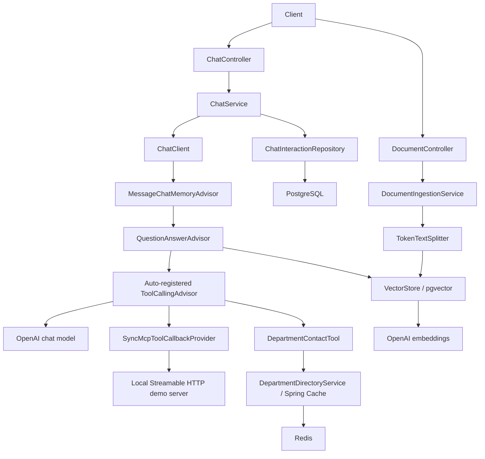

# Enterprise AI Assistant with Java Spring Boot

A small enterprise knowledge assistant for an AI Engineer / Java interview. It combines a layered Java application with retrieval-augmented generation (RAG), isolated conversation memory, a read-only business tool, Redis caching, and JPA audit persistence.

## Stack and architecture

Java 21, Maven, Spring Boot **4.1.2**, Spring AI **2.0.2**, OpenAI, PostgreSQL 17 + pgvector, Spring Data JPA, Redis 7.4, Spring Cache, Actuator, JUnit Jupiter, Mockito.



## Prerequisites and configuration

Install Java 21, Docker Desktop / Docker Compose, and optionally Maven 3.9+. Maven wrapper scripts are included. Set `JAVA_HOME` to a Java 21 JDK and confirm `java -version` / `./mvnw -version` (Windows: `.\mvnw.cmd -version`).

Copy `.env.example` to `.env` for Compose's local database settings. **The local JVM does not automatically load `.env`.** Set environment variables in the shell that starts Maven or the application. Never commit `.env` or a real key.

| Variable | Default / purpose |
|---|---|
| `OPENAI_API_KEY` | **Required; no default.** Key with chat and embedding access |
| `OPENAI_CHAT_MODEL` | `gpt-4o-mini`; must support tool calling |
| `OPENAI_EMBEDDING_MODEL` | `text-embedding-3-small`; requested dimensions fixed at 1536 |
| `POSTGRES_DB` | `enterprise_ai` |
| `POSTGRES_USER` | `enterprise` |
| `POSTGRES_PASSWORD` | `enterprise_dev`; local development only |
| `POSTGRES_PORT` | `5432` |
| `REDIS_HOST` / `REDIS_PORT` | `localhost` / `6379` |
| `MCP_DEMO_SERVER_URL` | `http://localhost:8090`; local Streamable HTTP MCP server |

PowerShell setup (key entry is masked; value is never echoed):

```powershell
Copy-Item .env.example .env
$env:OPENAI_API_KEY = [System.Net.NetworkCredential]::new('', (Read-Host 'OpenAI API key' -AsSecureString)).Password
$env:OPENAI_CHAT_MODEL = 'gpt-4o-mini'
$env:OPENAI_EMBEDDING_MODEL = 'text-embedding-3-small'
# Defaults are sufficient; export matching values if you customize .env.
$env:POSTGRES_DB = 'enterprise_ai'
$env:POSTGRES_USER = 'enterprise'
$env:POSTGRES_PASSWORD = 'enterprise_dev'
docker compose up -d --wait
.\mvnw.cmd spring-boot:run
```

For Bash, use `export NAME=value`, then `./mvnw spring-boot:run`. The service binds to `127.0.0.1:8080`. Only Actuator health is exposed. PostgreSQL, Redis, and the demo MCP server ports bind to localhost. Compose volumes retain data; `docker compose down` stops services without deleting those volumes.

Compose also starts a small Node.js MCP server at `http://localhost:8090/mcp`. It is a separate local demo process, not another Spring Boot application. Spring AI connects over Streamable HTTP, discovers `get_product_status`, and registers it on the existing `ChatClient` alongside the Java department-contact tool. The MCP tool only reads fixed synthetic status records for “Employee Portal” and “Payroll Portal”; it makes no external product connection and has no write operations. Keep this unauthenticated demo endpoint on localhost; do not expose it to a network.

Spring AI explicitly enables `spring.ai.vectorstore.pgvector.initialize-schema: true`. On startup it creates required extensions, the `vector_store` table, and the HNSW cosine index. Local Compose credentials have extension-creation privileges. JPA creates/updates `chat_interaction`; `open-in-view` is disabled. These development initialization choices should become controlled migrations in production.

## Browser workspace

After starting Spring Boot, open **http://127.0.0.1:8080/**. The chat interface is served by the same application from `src/main/resources/static/`; no Node server or frontend installation is needed. `/index.html` opens the same interface directly.

Type a question or select a suggested question, then press Enter or the send button. Shift + Enter inserts a new line. In Company knowledge, upload one PDF/TXT file or paste a title and text manually. The UI shows request progress, validation errors, and chunk counts. Uploads are extracted and processed in memory; raw files are not saved. New conversation creates a fresh ID; entering an existing ID reuses its server-side memory. The tab retains only the conversation ID in session storage, not the visible transcript. Refreshing clears displayed messages, while recent server memory remains available until the JVM restarts.

The API key stays on the server. Messages render as plain text; retrieved content and model output are never inserted as HTML. Company knowledge is shared across conversations in this local demo. If adding the interface to an already running process, rebuild and restart Spring Boot so its welcome-page mapping discovers `index.html`.

## API and examples

Use Bash curl below, or `curl.exe` in PowerShell 7. The file payloads in `demo/` avoid shell JSON quoting issues. See [DEMO.md](DEMO.md) for the full sequence.

```bash
curl http://localhost:8080/actuator/health
curl -X POST http://localhost:8080/api/documents -H 'Content-Type: application/json' --data-binary @demo/employee-handbook.json
curl -X POST http://localhost:8080/api/documents/upload -F 'file=@demo/employee-handbook.txt'
curl -X POST http://localhost:8080/api/documents/upload -F 'file=@/path/to/your-handbook.pdf'
curl -X POST http://localhost:8080/api/chat -H 'Content-Type: application/json' --data-binary @demo/rag-question.json
```

`POST /api/chat` accepts `{"conversationId":"demo-001","message":"What is the vacation policy?"}` and returns `conversationId`, `answer`, and `timestamp`.

`POST /api/documents` accepts `title` and `content`, and returns HTTP 201 with `documentId`, `title`, `chunkCount`, and `timestamp`. Ingestion is synchronous: 201 means embeddings and storage completed. Limits: title 200 characters, content 200,000, chat message 8,000, conversation ID 100. Conversation IDs allow letters, digits, underscores, and hyphens. Invalid inputs return 400; operational failures use sanitized error DTOs containing `code`, `message`, `status`, `timestamp`, `path`, and `fieldErrors`.

`POST /api/documents/upload` accepts one multipart field named `file` with a `.pdf` or `.txt` file. It returns HTTP 201 with `documentId`, sanitized `filename`, `fileType`, `chunkCount`, and `timestamp`. Uploads are limited to 10 MB; TXT must be UTF-8, extracted text must be nonblank and at most 200,000 characters, and PDFs must contain extractable text. Scanned/image-only PDFs require OCR before upload. Raw files are processed in memory and are not retained; extracted chunks are stored in pgvector. Errors use the existing sanitized error DTO.

Both ingestion methods use the same splitter, OpenAI embedding model, and pgvector store. For an end-to-end upload demo, start with `demo/employee-handbook.txt`, then ask a question such as `According to the employee handbook, what is the vacation carry-over limit?` using `POST /api/chat`.

## How the important flows work

**RAG ingestion:** Manual text follows `POST /api/documents` → Spring AI `Document` + metadata. PDF/TXT upload follows `POST /api/documents/upload` → PDFBox/UTF-8 text extraction → Spring AI `Document` + filename/type metadata. Both paths use the same `TokenTextSplitter` (about 500 tokens), OpenAI embedding model, and `VectorStore.add` into pgvector. For each chat turn, `QuestionAnswerAdvisor` searches the shared store (top 4, cosine similarity threshold 0.5) and adds retrieved text to the prompt. Retrieval runs outside the tool loop so it executes once per turn. These retrieval settings are starting points, not measured quality guarantees.

**Memory:** `MessageWindowChatMemory` retains up to 20 messages per conversation in this JVM. `ChatService` supplies `ChatMemory.CONVERSATION_ID` on every call. History is injected by `MessageChatMemoryAdvisor`; JPA history is a separate audit record and is not automatically replayed. Restarting loses memory. Client-selected IDs provide grouping, not authentication or ownership protection.

**Tools and cache:** `ChatClient.defaultTools` registers `getDepartmentContact` and the discovered MCP callbacks from `SyncMcpToolCallbackProvider`. Spring AI 2.0 automatically registers the tool-calling advisor: the model requests a Java or MCP tool, the corresponding server executes it, and the result returns to the model. The department lookup caches only deterministic email strings in Redis for ten minutes. The MCP example is a separate Streamable HTTP server returning static synthetic statuses; it does not connect to a real vendor. Repeated model turns can avoid a tool call using conversation history, so demos that prove tool invocation should use new conversation IDs.

To demonstrate MCP, start Compose, select **Try the MCP connection** in the browser, and submit the prompt. Or use `demo/mcp-product-status.json` with the chat API. `docker compose logs -f demo-mcp` shows the synthetic tool invocation. The tool is read-only and limited to two named demo products.

**Persistence:** completed interactions become `ChatInteraction` records with UUID, conversation ID, question, answer, and creation time. Repository saves occur after the provider call, avoiding a long database transaction. AI calls, memory updates, and audit writes are not atomic; a failed audit save returns an error and does not roll back model memory. Do not blindly retry complete chat requests.

## Build and test

```powershell
.\mvnw.cmd compile
.\mvnw.cmd test
.\mvnw.cmd package
.\mvnw.cmd dependency:tree
java -jar target/enterprise-ai-assistant-0.0.1-SNAPSHOT.jar
```

Tests run without keys, PostgreSQL, Redis, or external AI calls. MockMvc tests verify controllers and errors. Service tests verify chunking/metadata, completed audit persistence, and failure behavior. `AiFlowTest` uses the real advisor chain with a fake model and mocked vector store to verify RAG, conversation isolation, and tool execution. The cache proxy test uses an in-process cache; the manual demo verifies actual Redis. Fake-model tests prove wiring, not live answer quality.

## Layout and design decisions

`controller/` handles HTTP; `service/` orchestrates behavior; `repository/` handles JPA; `config/` wires AI, memory, and caching; `tool/` exposes the read-only function; `dto/`, `entity/`, and `exception/` keep boundaries explicit. Tests use standard `src/test/java`. Maintainable prompts live under `src/main/resources/prompts/`.

The MVP intentionally uses two tables (`chat_interaction`, `vector_store`), one application with a buildless browser interface, simple in-memory PDF/TXT parsing, and no extra orchestration framework. Re-ingestion creates new document IDs; there is no deduplication, replace/delete API, or guaranteed cross-batch ingestion rollback. Basic RAG does not rewrite ambiguous follow-up queries from history. In-memory conversation count is unbounded, and concurrent turns with the same ID can race; use sequential demo requests.

Use synthetic content only. Logging avoids raw questions, answers, retrieved text, keys, and provider exception messages. A prompt helps discourage hallucinations and document prompt injection but is not an authorization boundary. Before production add identity and conversation ownership, document ACL/tenant filters, persistent memory, migrations, timeouts/retry policy, rate limits, PII controls, retention, observability, and retrieval/answer evaluation.

## Official references

- [Spring AI compatibility and BOM](https://docs.spring.io/spring-ai/reference/getting-started.html)
- [Spring AI RAG and current advisor artifact](https://docs.spring.io/spring-ai/reference/api/retrieval-augmented-generation.html)
- [Spring AI 2.0 tool and API migration notes](https://docs.spring.io/spring-ai/reference/upgrade-notes.html)
- [pgvector configuration](https://docs.spring.io/spring-ai/reference/api/vectordbs/pgvector.html)

See [INTERVIEW_GUIDE.md](INTERVIEW_GUIDE.md) for explanations, interview questions, and production tradeoffs.
